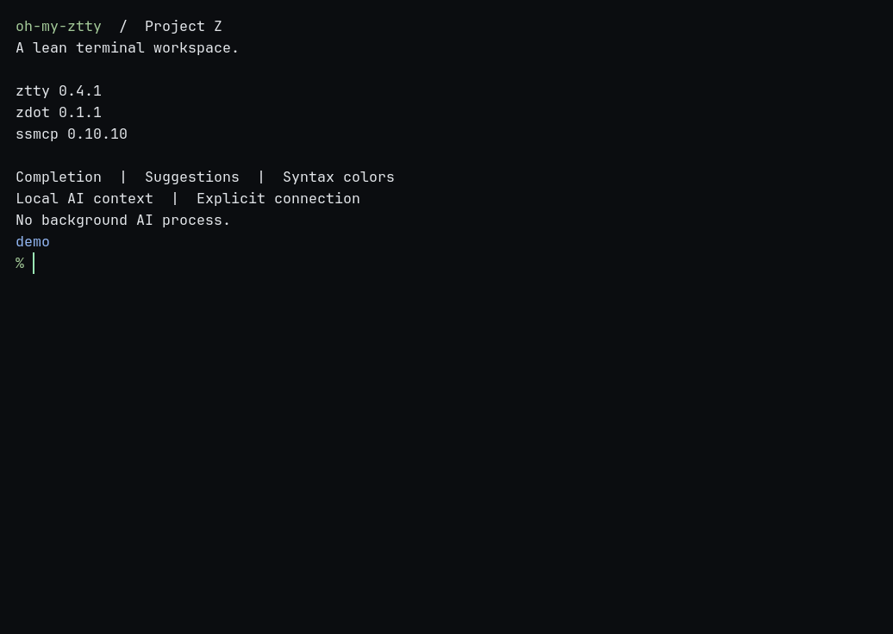

# oh-my-ztty

A lean Linux terminal setup built on Project Z: **ztty + zsh + zshard + zdot + ssmcp**.

[Website](https://lightjunction.github.io/oh-my-ztty/) · [中文](README.zh-CN.md) · [Install guide](docs/installation.md) · [Performance](docs/performance.md)

## Install

Download and inspect the installer, then run it:

```sh
curl -fLO https://github.com/LIghtJUNction/oh-my-ztty/releases/latest/download/install.sh
sh install.sh
~/.local/bin/omztty shell
```

Linux x86_64 and ARM64. Requires system zsh; the graphical terminal uses X11/fontconfig. The bundle includes all four Project Z components. Installation is per user and repeatable. Your login shell and existing tools remain available.

## The suite

| Component | Job |
| --- | --- |
| [ztty](https://github.com/LIghtJUNction/ztty) | Native terminal |
| [zshard](https://github.com/LIghtJUNction/zshard) | Original zsh framework: completion, suggestions, highlighting and lazy plugins |
| [zdot](https://github.com/LIghtJUNction/zdot) | `no_std` dotfiles manager with plans, reversible links and explicit Git sync |
| [ssmcp](https://github.com/LIghtJUNction/ssmcp) | On-demand MCP workspace connection for AI |

Each is a separate open-source repository, pinned here as a Git submodule. zsh is supplied by your Linux distribution.

## Ink preset

A graphite palette, generous spacing and a two-line prompt with the path, cached Git branch and command status. The prompt uses zsh builtins; installed fonts fall back through Fontconfig. [Customize the preset](docs/installation.md#ink-appearance).



## Everyday commands

```sh
omztty terminal        # Open ztty with the suite's zsh configuration
omztty shell           # Try the shell in your current terminal
omztty doctor          # Check binaries and system dependencies
omztty ai context      # Emit explicit shell context
omztty ai connect      # Start ssmcp in your workspace
omztty dot plan --root ~/dotfiles --target "$HOME"  # Preview dotfile changes
omztty update          # Install the latest suite release
omztty uninstall       # Remove this installation's managed files
```

AI-generated commands are reviewed in the shell input line before execution. The suite does not start an AI model or resident agent at shell startup.

## Develop together

```sh
git clone --recurse-submodules https://github.com/LIghtJUNction/oh-my-ztty.git
cd oh-my-ztty
python3 scripts/workspace.py status
```

[Development and release guide](CONTRIBUTING.md) covers local checks, component updates and one-command version bumps. [Architecture](docs/architecture.md) describes the runtime boundaries and extension interfaces.

MIT license. Performance claims and their measurement conditions belong together; see [the benchmark record](docs/performance.md).
