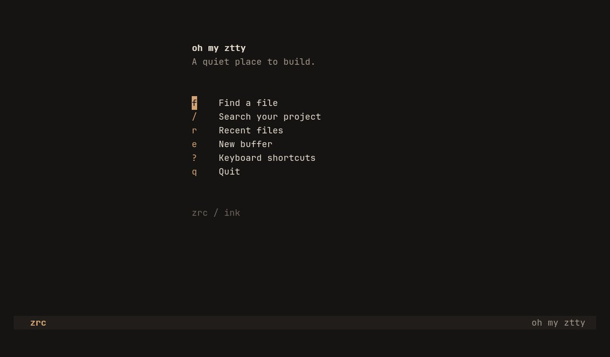

# oh-my-ztty

基于 Project Z 的 Linux 工作环境：**ztty + zshard + zrc + zdot + zfetch + ssmcp**。系统 zsh 负责执行命令，套件统一终端、编辑器和常用工具的配置。

[官网](https://lightjunction.github.io/oh-my-ztty/) · [English](README.md) · [安装说明](docs/installation.md) · [配置与恢复](docs/configuration.md) · [性能记录](docs/performance.md) · [0.2.1 实机报告](docs/reports/workspace-0.2.1.md)

原生 Tab 补全覆盖套件组件、Codex／Claude／Gemini／OpenCode／pi／Amp、Go／Rust／Node 开发命令，以及 Project Z 等自研 CLI；Git、uv、Cargo 等复用已安装的系统补全。支持多级命令、参数取值与中文路径，个人补全规则优先。详见[补全说明](docs/configuration.md#native-completion)与[覆盖清单](docs/completions.md)。

## 安装

### 用户级发行包

先下载并查看安装脚本，再执行：

```sh
curl -fLO https://github.com/LIghtJUNction/oh-my-ztty/releases/latest/download/install.sh
sh install.sh
~/.local/bin/omztty shell
```

支持 Linux x86_64、ARM64。系统需提供 zsh 5.9+；图形终端使用 X11/XWayland，正式构建在 Ubuntu 24.04 验证。安装包包含六个 Project Z 组件的运行程序或原生配置，按用户安装，可重复执行，无需在安装时配置 Rust 或 Python。使用编辑器配置需要另行安装 Neovim 0.11+；日常运行和配置部署也不需要 Rust 或 Python。

### Arch Linux（AUR）

通过 AUR 助手安装 [oh-my-ztty-bin](https://aur.archlinux.org/packages/oh-my-ztty-bin)：

```sh
yay -S oh-my-ztty-bin
omztty doctor
```

系统软件包通过 AUR 助手更新，配置采用仍需执行下方命令。卸载软件包前，先运行 `omztty config remove` 恢复原配置，再通过包管理器移除软件包。未使用 AUR 助手时，可按[安装说明](docs/installation.md#arch-linux-aur)使用 `makepkg` 安装。

## 六个独立项目

| 项目 | 作用 |
| --- | --- |
| [ztty 0.5.2](https://github.com/LIghtJUNction/ztty/tree/v0.5.2) | 原生终端 |
| [zshard](https://github.com/LIghtJUNction/zshard) | zsh 框架，提供补全、历史建议、命令高亮和延迟加载插件 |
| [zrc 0.1.2](https://github.com/LIghtJUNction/zrc/tree/v0.1.2) | Neovim 与常用终端工具的原生配置，共用暖色 Ink 外观 |
| [zdot](https://github.com/LIghtJUNction/zdot) | `no_std` 配置管理工具，预览、部署链接、备份和恢复，并显式执行 Git 同步 |
| [zfetch 0.1.1](https://github.com/LIghtJUNction/zfetch/tree/v0.1.1) | 零 crate 依赖的原生 `no_std` 系统概况工具，按需运行 |
| [ssmcp 0.10.20](https://github.com/LIghtJUNction/ssmcp/tree/v0.10.20) | 按需把工作区接入 AI 的 MCP 工具 |

以上是 oh-my-ztty 0.2.6 选用的组件版本，源码提交由 Git 子模块固定。zsh、Neovim 等系统应用需单独安装。进入 shell 后，可按需查看系统概况或启动 AI 连接。zfetch 的 Arch Linux 包名为 `zfetch-project-z` 与 `zfetch-project-z-bin`，发布状态见其仓库说明。

## Ink 默认外观

暖石墨背景、亚麻白文字、铜色重点、28 px 内边距与两行提示符，把路径、Git 分支和输入区分开。Neovim 与终端工具沿用同一套配色。提示符使用 zsh 内置能力；字体通过 Fontconfig 回退，不强制安装图标字体。[自定义预设](docs/installation.md#ink-appearance)。



这是隔离显示中运行已部署配置的实际截图。记录机器的真实桌面启动链已另行通过新 broker、程序执行和复用验收，默认入口现为 oh-my-ztty；详见[报告、恢复过程与验收范围](docs/reports/workspace-0.2.1.md)。

## 设为默认工作环境

先准备可编辑配置并查看部署计划，再备份已有文件、应用链接：

```sh
omztty config init
omztty config plan --json
omztty config apply --backup
omztty config status
```

统一配置覆盖 zsh、ztty、Neovim、Kitty、Foot、Ghostty、tmux、fzf、bat、ripgrep 和 Git 显示设置；应用程序本身单独安装。Git 配色通过配置说明中的显式 include 启用。采用配置后重新打开终端，账户的登录 shell 记录保持原值。

编辑源文件位于 `~/.config/oh-my-ztty/profile/`，个人 shell 设置放在 `~/.config/oh-my-ztty/local.zsh`，个人补全放在 `~/.config/oh-my-ztty/completions/`。对应 XDG 配置可改变这些位置；HOME 配置部署要求 `XDG_CONFIG_HOME` 位于 HOME 内。

升级后运行 `omztty config refresh`，即可更新尚未自行修改的默认文件；个人编辑、新增文件和主动删除的文件会保留。`omztty config remove` 恢复采用配置前保存的文件。用户级安装的 `omztty uninstall` 会先恢复这个受管理的 profile；恢复失败时保留运行程序供修复。通过 `omztty dot` 部署的其他仓库独立管理。完整位置与恢复步骤见[配置说明](docs/configuration.md)。

## 常用命令

```sh
omztty terminal        # 用 ztty 打开预设 shell
omztty shell           # 在当前终端体验
omztty info            # 按需运行 zfetch，显示系统概况
omztty zfetch          # 直接运行套件中的 zfetch
omztty doctor          # 检查组件和系统依赖
omztty config audit    # 检查统一配置及已知旧 shell 框架位置
omztty ai context      # 输出明确选择的 shell 上下文
omztty ai connect      # 在当前工作区启动 ssmcp
omztty update          # 更新用户级安装
omztty uninstall       # 先恢复配置，再卸载用户级安装
```

AI 建议的命令先进入输入行，由人确认执行。个人配置、补全与历史位于发行版目录之外，更新或卸载时保留。

## 一起迭代

```sh
git clone --recurse-submodules https://github.com/LIghtJUNction/oh-my-ztty.git
cd oh-my-ztty
python3 scripts/workspace.py status
```

开发、测试和发布见 [CONTRIBUTING.md](CONTRIBUTING.md)。性能数字与测量范围见[性能记录](docs/performance.md)。项目采用 MIT 许可证。
