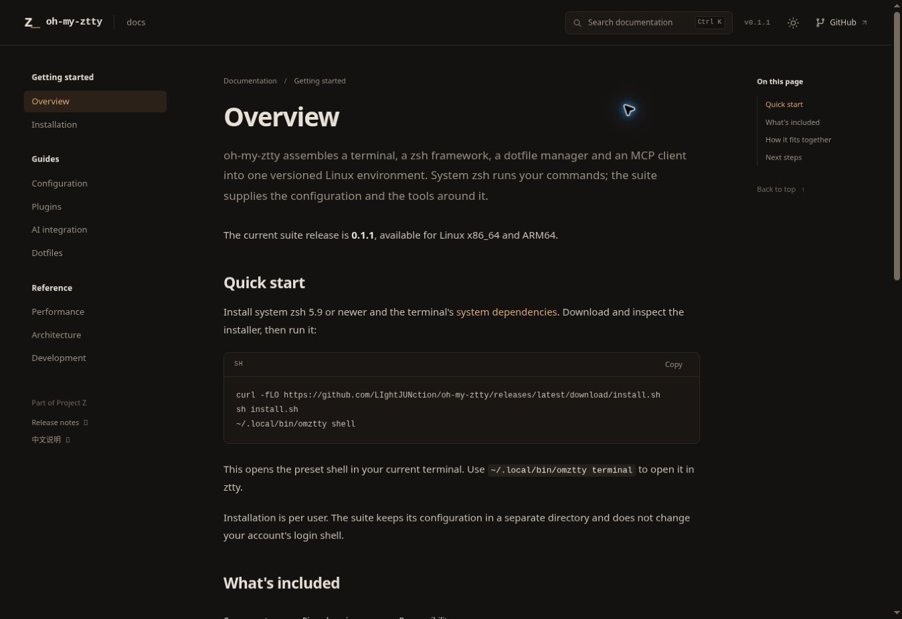

# Website redesign verification — 2026-11-20

The public website is now a Markdown documentation site with a warm neutral palette. The date in this record uses Asia/Taipei.

## Published result

- Website: https://lightjunction.github.io/oh-my-ztty/
- Main redesign: [bb1d990](https://github.com/LIghtJUNction/oh-my-ztty/commit/bb1d990592bd1c8ec68e9a4f15a4b1e68a91a10a).
- Search wrapping fix: [c1d2c85](https://github.com/LIghtJUNction/oh-my-ztty/commit/c1d2c85645ef79e9800df6e26fb1ea99396c647c).
- Final website deployment: [Publish website #44618167099](https://github.com/LIghtJUNction/oh-my-ztty/actions/runs/44618167099), completed successfully.
- Suite version remains 0.1.1. This change concerns the documentation website, its build process and contributor documentation.

## Design and content

The site uses a chapter sidebar, a central article, a page outline and previous/next navigation. Narrow layouts replace the sidebar and outline with disclosures. Dark and light themes use warm black, off-white, gray and copper. Links, focus states, selection colors and the favicon follow the same palette.

Nine Markdown source pages cover Overview, Installation, Configuration, Plugins, AI integration, Dotfiles, Performance, Architecture and Development. The build creates static HTML. Search loads a local index when opened; theme switching and code-copy controls use the site's small JavaScript file. There are no client-rendered Markdown dependencies, external fonts or analytics.

Sources: [content](../../site/content), [navigation](../../site/nav.json), [template](../../site/template.html), [styles](../../site/style.css), [interaction code](../../site/app.js), [builder](../../scripts/build_site.py), [build instructions](../../site/README.md).

## Verification

| Check | Observed result |
| --- | --- |
| Static build | 9 documentation pages; 17 output files; 217,211 bytes for the complete output directory. This is a byte count, not a page-load benchmark. |
| Internal links | 450 local links and anchors validated by the builder. |
| Source checks | JavaScript syntax and Git whitespace checks passed. Builder fixtures covered escaping, heading IDs, relative links, search records and safe output replacement. |
| Palette | 37 explicit color literals in the stylesheet, template and favicon were neutral or warm; their RGB channels satisfied R >= G >= B. |
| Desktop | The live site was inspected in Chromium at 1363 × 936 CSS pixels. The article, sidebar, outline, code blocks and both themes rendered. |
| Search | Searching for “completion” returned seven pages. Arrow-down and Enter opened Plugins. |
| Navigation | The narrow chapter menu opened and navigated to Installation. The installation outline expanded and its selected anchor updated the URL. |
| Narrow layout | Chrome at 400% zoom exposed a 340 × 234 CSS-pixel viewport. Document scroll width was 337 pixels; long code and tables scrolled within their containers. |
| Long search text | A 180-character unbroken query originally overflowed its status container: 271-pixel client width versus 1,164-pixel scroll width. The deployed wrapping fix reduced both widths to 271 pixels. The dialog remained 299 pixels wide. |
| Copy control | The button reported “Copied” and the DOM target contained the visible code. Exact clipboard round-trip verification was inconclusive: the automation clipboard returned empty text while desktop paste returned an earlier sample. |

The narrow-layout check used desktop browser zoom, not a physical phone. The browser's developer tools were disabled by its organization policy; no policy or browser security settings were changed. A real mobile-device pass and a normal-browser clipboard round-trip remain outside this verification record.

## Screenshot

The image is an unedited capture of the deployed homepage. Any blue pointer halo belongs to the inspection browser, not the website palette.

- File size: 73856 bytes
- SHA-256: `7d4de3acb619327b219c5e6e3ca612f5232d954df88d7c627596d479fba82e2e`
