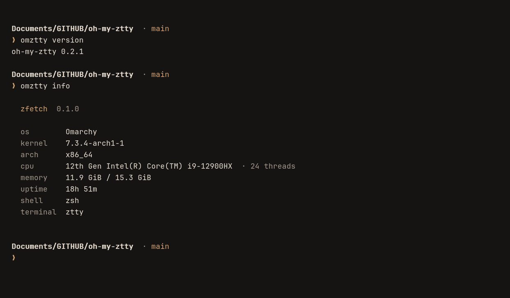
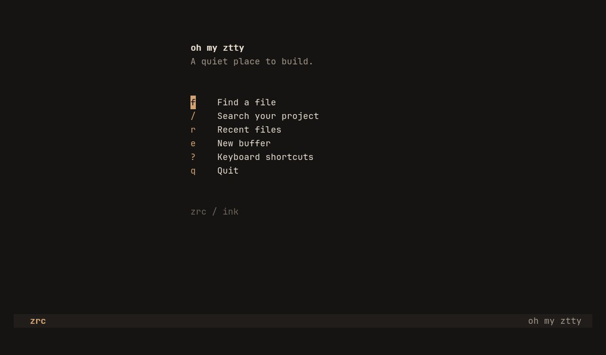
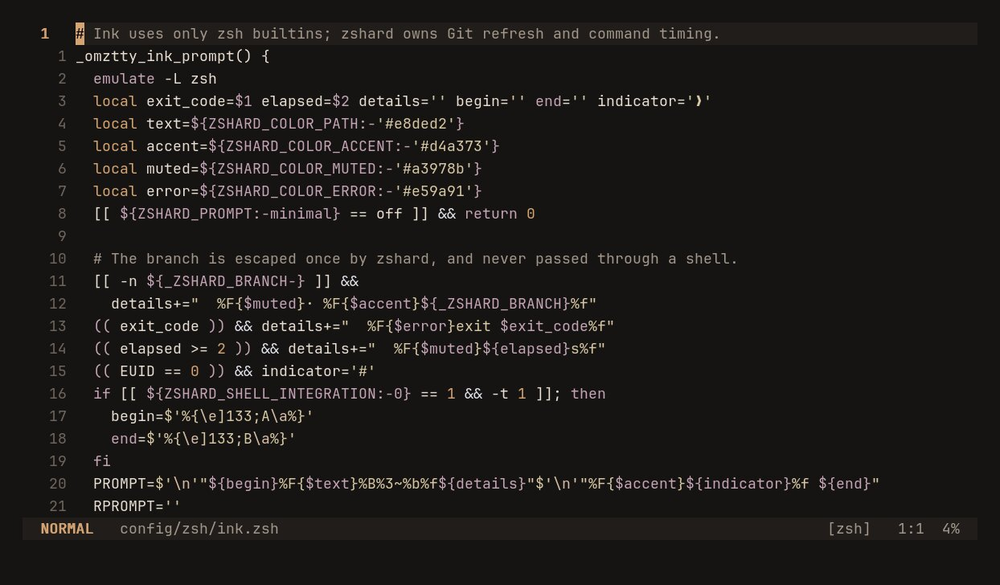

# oh-my-ztty 0.2.1：实机迁移、发布与验收边界

记录范围：2026-11-19 至 2026-11-20 UTC；运行版本为 **0.2.1**。本报告公开可复核的程序、配置结构、测量样本和验收边界，个人配置内容、环境值和历史记录不进入公开材料。

**正式双架构发布、HOME 配置迁移和真实宿主桌面的默认启动链均已通过。** 宿主 `DISPLAY=:0` 最初因另一私有 Xvfb 占用显示端点而拒绝新连接；旧系统终端 broker 的既有连接仍可工作。所属私有桌面 owner 释放冲突资源后，已有受保护启动器恢复了 XWayland 入口；同一个官方 0.2.1 二进制随后通过新 broker、实际窗口、shell 执行和默认链复用验收。默认入口现为 `oh-my-ztty.desktop`。SSMCP 的显示资源防复发修改仍待正式交付。[宿主实际验收](workspace-0.2.1/actual-desktop.json) · [汇总记录](workspace-0.2.1/workstation-acceptance.json)

| 验收层次 | 本轮状态 | 已证明的范围 |
| --- | --- | --- |
| 正式发行版 | pass | Linux x86_64、aarch64 原生发布检查；公开资产和文件校验 |
| 实际 HOME 配置 | pass | 21 项 zdot 映射、幂等重用、普通与登录 shell、原生 Neovim |
| 隔离图形显示 | pass | 实际窗口、键盘输入、首次 Tab 缓存复用、截图 |
| 宿主桌面默认终端 | pass | 真实会话中的新 broker、正常窗口、默认启动链、外部命令与复用 |
| 新共享依赖组合传播 | **pending** | 等待上游应用正式资产，以及 Project Z 登记提交 |

## 1. 交付的运行版本

0.2.1 将六个独立项目组合为一个发行版。zsh 执行用户命令；zshard 在当前 shell 内处理提示符与编辑功能；zrc 提供应用原生配置；zdot 管理配置链接和恢复；zfetch、ssmcp 通过明确命令按需运行。安装与使用发布包不需要现场编译 Rust 或运行 Python，系统应用及图形库的要求见[安装说明](../installation.md)。

本次运行版本的套件源码是 [7b69b751772a839f090e408228d94f810fd96d1e](https://github.com/LIghtJUNction/oh-my-ztty/commit/7b69b751772a839f090e408228d94f810fd96d1e)。两个正式归档的 `BUILD.json` 记录相同的六个源码固定点；以下以该记录为准，不能用各组件之后移动的 main 分支代替。[公开发布审计](workspace-0.2.1/release-audit.json)

| 组件 | 版本 | 本次固定源码 |
| --- | --- | --- |
| ztty | 0.4.1 | [6b91e29e923aaee0207953f2b04393087f19e0d8](https://github.com/LIghtJUNction/ztty/commit/6b91e29e923aaee0207953f2b04393087f19e0d8) |
| zshard | 0.2.0 | [1cfa1a1eb761d14e2ccfd5381282b6ccd1491cff](https://github.com/LIghtJUNction/zshard/commit/1cfa1a1eb761d14e2ccfd5381282b6ccd1491cff) |
| zrc | 0.1.0 | [ef8bd9571e206c8086e38b9dcbdc760a466b5133](https://github.com/LIghtJUNction/zrc/commit/ef8bd9571e206c8086e38b9dcbdc760a466b5133) |
| zdot | 0.2.0 | [e6b5feb98b05c59e0986624c0742dfe4a9187a2a](https://github.com/LIghtJUNction/zdot/commit/e6b5feb98b05c59e0986624c0742dfe4a9187a2a) |
| zfetch | 0.1.0 | [f19b278676206d76626dd01e4b89f7ad9ce9318f](https://github.com/LIghtJUNction/zfetch/commit/f19b278676206d76626dd01e4b89f7ad9ce9318f) |
| ssmcp | 0.10.10 | [52a531a59e9ec9236a76eafc0f4f068799e44b15](https://github.com/LIghtJUNction/ssmcp/commit/52a531a59e9ec9236a76eafc0f4f068799e44b15) |

本轮报告和截图属于发布后的文档证据；增加这些材料不会改变已经发布的 0.2.1 归档。

## 2. 默认外观与应用配置

Ink 使用暖石墨背景、亚麻白文字、铜色重点和较大的留白。终端预设请求 13 pt 字体、28 px 内边距；两行提示符把目录、Git 分支、上一条命令状态和输入位置分开。Neovim 沿用同一套颜色，默认页面、文件编辑和状态栏不依赖图标字体或在线插件引导。[配置说明](../configuration.md) · [固定的 zrc 配置源码](https://github.com/LIghtJUNction/zrc/tree/ef8bd9571e206c8086e38b9dcbdc760a466b5133)

**以下三张是实际程序运行截图，使用已经部署的配置，在隔离显示 `:1` 中拍摄。** 它们展示终端与编辑器的实际布局。宿主 `:0` 的通过结论另由窗口映射、新 broker 和程序执行记录支持；本报告不将这三张图标作宿主截图。[独立的宿主证据](workspace-0.2.1/actual-desktop.json)

### 终端与按需系统概况

`omztty info` 显式运行 zfetch；正常打开 shell 不自动打印系统概况。

### Neovim 默认页面

原生默认页面提供文件查找、最近文件、新缓冲区和快捷键入口。

### Neovim 编辑公开项目代码

截图打开的是本仓库的公开提示符代码，展示实际行号、语法颜色、模式与文件状态。

zrc 本轮交付 10 个配置模块：Neovim、Kitty、Foot、Ghostty、tmux、fzf、bat、ripgrep、Git 显示设置和 shell 设置。套件再组合自身的 zsh、ztty 入口。配置模块的存在与应用已安装、已运行是不同的验收项：本机实际验收覆盖 shell 和 Neovim 等记录中的路径；**tmux 未安装，未做运行验收**，不能把 10 个模块写成 10 个应用均已实测。Neovim 配置需要 0.11 或更新版本；本轮以原生配置替换旧 LazyVim 配置，功能集合有所变化。

## 3. 用 zdot 管理实际 HOME

实际用户环境已经通过 zdot 部署 **21 项映射**，并通过重复应用的幂等检查。配置源放在 `~/.config/oh-my-ztty/profile`，状态和备份使用独立的 `~/.local/state/zdot/oh-my-ztty`，不再把管理状态散放到 HOME 根目录。个人补全位于配置树内，独立于可卸载的版本化运行目录。[验收记录](workspace-0.2.1/workstation-acceptance.json) · [配置与恢复](../configuration.md)

旧 `.zshrc` 为 **1,922,585 bytes**，其中大段内容是内嵌 Binance 补全。迁移把完整补全尾部移到独立的自动加载文件，新 HOME 入口为 **387 bytes**。这减少的是启动时解析的大块脚本，不是声称功能代码凭空消失；补全仍然存在，需要时才加载。

迁移前逐项核对了个人 PATH、PNPM、Go 工作区推导、额外补全路径、GPG/SSH、私有环境加载、别名、LightFlow 和 YDOTOOL 设置。`.zshenv`、`.zprofile` 保留原内容，Git 只追加显示配置 include；Bun 补全改为通过已有 `#compdef` 文件自动加载。历史导入量为 **41,901 bytes**，旧历史文件保留，避免破坏仍在运行的会话。公开仓库只记录保留检查与计数，不包含这些私有文件。

GPG 初始化随后做了一项有限修改：复制原 hook 到已有受管配置目录，只去掉重复的 `gpgconf --launch gpg-agent`，保留连接 agent、更新终端和查询 SSH socket 的行为。原 hook 未改动，隔离子 shell 的原、新环境比较一致；新的普通和登录 shell 都确认 SSH socket 值一致且为有效 socket。这项改动属于本机个人配置，没有被塞进公共默认配置，也没有新增 zdot 映射。

### 旧框架退役与恢复

旧 Zim、Powerlevel10k、Oh My Zsh 和 Starship 启动配置在替代配置验收后退役。恢复归档包含 **1,566 项**，普通文件内容合计 **87,244,510 bytes**；压缩包为 **81,719,145 bytes，约 81.7 MB**。归档和恢复 helper 保留在本机，恢复检查通过；公开材料不包含归档内容。[维护摘要](workspace-0.2.1/maintenance-summary.json)

清理不等于卸载所有同名软件。系统 Starship 包因其他软件包依赖仍被保留，但新 shell 不再初始化它；正在使用的项目、服务和独立配置仍按各自生命周期管理。恢复材料本身也占用磁盘，不能计入“已经释放的空间”。

## 4. 启动测量：结果与因果边界

测量使用同一台开发机，分别记录迁移前、初次采用配置后、后续 GPG 精简后的状态。每个阶段、每种命令有 **3 次预热和 31 个正式样本**，不同命令种类交错执行。计时从创建子进程到阻塞等待其退出；标准输出和错误丢弃，`TERM=xterm-256color`，工作目录为 HOME。[全部原始样本](workspace-0.2.1/startup.json)

执行的命令为：

~~~sh
zsh -i -c exit
zsh -l -i -c exit
nvim --headless -i NONE +qa!
~~~

**表：相同采样方法下的启动墙钟时间，单位 ms，数值越小表示该次测量耗时越短。**

| 工作负载 | 迁移前中位数 | 初次采用后中位数 | 最后快照中位数 | 最后快照 p95 |
| --- | ---: | ---: | ---: | ---: |
| 普通交互 zsh | 125.227 | 23.133 | 10.411 | 16.958 |
| 登录交互 zsh | 159.331 | 70.872 | 35.376 | 51.363 |
| Neovim headless 启动并退出 | 37.723 | 15.208 | 9.379 | 12.448 |

这些结果支持“这台机器采用新配置后的记录更快”，不能推出所有机器上的速度排名。shell 命令不等待用户看到并操作第一个提示符，Neovim 命令不测图形首帧、项目索引或语言服务器启动。旧 shell 框架与新框架、旧 LazyVim 与新原生配置的功能集合也不完全相同。

**三个阶段是顺序快照，后台负载没有冻结。** 最后一次 Neovim 测量也明显变快，而 GPG hook 不属于它的配置修改，因此不能把初次采用到最后快照的全部差值归因于删除那条 GPG 命令。报告保留两个“采用后”阶段，避免只挑选最后的最低数字。

剩余登录 shell 开销还包含系统登录 profile：本轮短时诊断观察到 Flatpak、debuginfod 和 gpm 脚本，以及保留的个人 GPG/SSH 初始化。进程跟踪用于找调用来源，会放大耗时，未混入上表。未为了降低数字而跳过这些系统环境设置。历史框架微基准与本轮完整个人环境启动也应分开阅读，见[性能记录](../performance.md)。

## 5. zfetch：原生、按需，以及可比较的范围

zfetch 0.1.0 已正式发布，并有两个 AUR 包：[zfetch-project-z](https://aur.archlinux.org/packages/zfetch-project-z) 从源码构建，[zfetch-project-z-bin](https://aur.archlinux.org/packages/zfetch-project-z-bin) 安装官方二进制。命令名仍是 `zfetch`；套件入口为 `omztty info` 或 `omztty zfetch`。[zfetch 正式发布](https://github.com/LIghtJUNction/zfetch/releases/tag/v0.1.0)

它使用 Rust `no_std`，没有 Cargo crate 依赖，直接读取 Linux 系统信息；没有子进程、网络请求或常驻服务。这里的轻量设计是缩小启动路径和查询范围：默认概况只显示已实现的系统字段，不在 shell 启动时自动运行，也不默认展示用户名、主机名、IP 或序列号。[实现与选项](https://github.com/LIghtJUNction/zfetch/tree/v0.1.0)

**必须区分正式文件与基准文件。** zfetch 自身的官方 x86_64 0.1.0 可执行文件为 **22,808 bytes**；下面性能实验使用的是本机链接的 **23,288-byte** 文件。二者对应同一版本，但构建环境和文件字节不同，不能把计时直接标注成官方文件的结果。[发布证据](https://github.com/LIghtJUNction/zfetch/blob/8f8f6fd6f1f4894829aecab2e9d33d8e77a8fb92/docs/evidence/release-0.1.0.json)

组件实验进行了 100 次交错暖运行，包含进程创建与等待退出。zfetch JSON 的中位数为 **0.385 ms**，fastfetch 2.71.0 选择相近核心模块的 JSON 为 **2.503 ms**。两者实现的字段仍有差异；约 6.5 的时间比描述这组工作负载，不代表完整 fastfetch 功能的等价替代速度。范围更大的 fastfetch 默认输出另行测量，不能混作同一基线。[方法和限制](https://github.com/LIghtJUNction/zfetch/blob/8f8f6fd6f1f4894829aecab2e9d33d8e77a8fb92/docs/performance.md) · [原始样本](https://github.com/LIghtJUNction/zfetch/blob/8f8f6fd6f1f4894829aecab2e9d33d8e77a8fb92/docs/benchmarks/linux-x86_64-0.1.0.json)

## 6. 发布验收与宿主显示恢复

### 正式资产

[0.2.1 正式工作流 44637134764](https://github.com/LIghtJUNction/oh-my-ztty/actions/runs/44637134764) 的 Linux x86_64、aarch64 原生发布检查均成功。公开下载审计确认 **6 个资产**：安装器及其摘要、两个架构归档及各自摘要。每个归档的 **84 个文件**通过清单校验，ELF 架构正确；下载回来的 x86_64 正式包又通过安装生命周期检查。[正式发布](https://github.com/LIghtJUNction/oh-my-ztty/releases/tag/v0.2.1) · [逐项审计](workspace-0.2.1/release-audit.json)

| 正式归档 | 大小，bytes | SHA-256 |
| --- | ---: | --- |
| Linux x86_64 | 5,291,545 | `2e3f86191a3d461d9ad2a330a9b323fd261696bf273622cd9d31de9c90a64861` |
| Linux aarch64 | 5,100,813 | `0ccf5494e0fd09341884c2372fe77be4b56425a4a8a2aa1815928f49ee2a1b0c` |

### 首次 Tab 的缓存回归

0.2.0 的正式构建曾在两个架构上发现：第一次按 Tab 改写了安装阶段预热的补全缓存。原因是安装预热与实际 shell 的 `fpath` 不同；缓存指纹包含整个有序路径列表，即使个人补全目录不存在，额外路径也会使指纹改变。

0.2.1 让安装器和正常启动读取同一份补全路径设置。安装器使用干净 shell 预热，保持不执行个人 startup hooks、失败不切换活动版本的边界；个人完整配置可以另外显式预热。原来的缓存 SHA-256 与 mtime 严格相等断言没有放宽。[0.2.0 失败工作流](https://github.com/LIghtJUNction/oh-my-ztty/actions/runs/44634712018) · [0.2.1 本机图形记录](workspace-0.2.1/local-graphical.json)

本机图形记录中的首次 Tab 前后缓存摘要和修改时间相同，`reused=true`。该记录使用的**本机候选包**摘要为 `403fa35edee7398e0002428d12108874b8ac38fcfe2460279b2c59c720e67fd4`；它与上表 GitHub 正式归档不是同一组字节。记录中的内存与短时启动数据只属于那个候选包和隔离显示环境，不转移到正式包或实际宿主桌面。

### 桌面命令协议与真实连接是两项检查

桌面入口已按终端协议声明 `-e`，参数转发检查覆盖包含空格的路径和命令参数，结果通过。该记录本身只证明入口选择与 argv 构造；当前默认选择器与真实显示连接由后续的宿主记录独立确认。[协议记录](workspace-0.2.1/desktop-protocol.json) · [宿主验收](workspace-0.2.1/actual-desktop.json)

**实际宿主验收在显示资源恢复后通过，运行二进制没有修改。** 最初的新 `:0` 连接命中了占用相同地址的私有 Xvfb，旧 broker 既有连接则继续工作。因此恢复期间先把默认入口退回可用的 `ztty.desktop`，保留用户开终端的能力。所属私有桌面 owner 通过原生停止操作释放冲突资源后，已有受保护的 `ztty-launch` 恢复 `X0 → X0_` 入口；真实 XWayland 保留，没有导入私有显示的认证，也没有为此修改 ztty 代码或发布新运行版本。[恢复与实际验收](workspace-0.2.1/actual-desktop.json)

独立的新连接检查随后成功，套件通过全新的唯一 socket 创建了不同于旧系统 broker 的进程；窗口实际映射，shell marker 证明命令在套件 shell 中执行。这个临时窗口和 broker 已自动退出。**恢复过程中另一次 fresh 前置检查曾暂时失败，当时在修改默认偏好之前立即中止。** 记录没有据此编造第二个根因；后续带跟踪的新连接检查和完整默认链验收均通过。

最终实际入口依次经过 `omarchy-launch-terminal`、`uwsm-app`、`xdg-terminal-exec` 和 `omztty terminal`，选择器为 `oh-my-ztty.desktop`。新的默认 broker 打开正常映射窗口，其中运行 zsh；再启动的外部命令通过 marker 校验并复用同一 broker，临时命令窗口自动退出，正常终端保留可用。配置 symlink 和 `0600` 权限保留，启动日志为空。**本轮没有注入实际物理快捷键按键**；快捷键源码绑定链此前已核对，本轮直接验收真实启动链和程序行为。隔离截图不被用于证明这一宿主结果。

显示资源的防复发修改仍有明确接手人。现有 SSMCP 应用/私有桌面 owner 已于 2026-11-20 00:24 UTC 确认接收，在 `fix/private-display-allocation-20261120` 推进高号显示分配、同用户串行化、端点归属/就绪检查及仅清理自有资源。该修复的正式应用资产尚未交付，继续列为开放项。当前默认入口已恢复；`omztty doctor` 的显示环境存在性检查仍不能代替实际新连接验收。

## 7. 清理记录：逻辑量与实际可用空间

清理使用各工具的原生功能，并把可重新获取的缓存与恢复材料分开处理。以下数据是本轮原生维护记录的归纳；私有路径和文件清单不公开。[维护摘要](workspace-0.2.1/maintenance-summary.json)

| 项目 | 原生操作与记录 | 计量边界 |
| --- | --- | --- |
| mise | `mise cache clear`；清理前逻辑占用 16,036,828 KiB，约 15.3 GiB | 保留已安装工具；不是物理释放量 |
| Go | `go clean -cache`；逻辑占用 7,124,520 KiB → 8 KiB | 操作前检查活动进程及引用；逻辑文件量 |
| uv | `uv cache prune --offline`；原生报告 495.4 MiB | 工具自身的清理报告 |
| 两个旧 Cargo target | `cargo clean`；分别报告 243.5 MiB、48 MiB | 不合并冒充文件系统新增可用空间 |
| 另一处 target | 因缺少有效 `CACHEDIR.TAG` 被保护逻辑拒绝 | 保留原保护，没有绕过 |

Go 清理前后观察到的文件系统可用空间为 **19,296,174,080 → 20,841,717,760 bytes**，差值约 **1.44 GiB**；这是单独的可用空间观察，不是对全部清理动作的归因。末次记录的可用空间为 **20,812,275,712 bytes，约 19.4 GiB**。开发机仍有其他活动，不能把不同时间的工具逻辑量相加，声称释放了同等物理空间。

## 8. 依赖传播仍开放的交接

新组件进入套件，不代表 Project Z 的协调登记已经提交。2026-11-20 UTC 本轮核查时，协调者的本地工作图已识别 zrc、zfetch 和套件六条直接依赖，但登记修改与更新后的消费者 gitlink 尚未形成正式提交并推送。公开协调分支检查点仍为 [b27ef85165902bcce1b583233d958bfaa8f76689](https://github.com/LIghtJUNction/project-z/commit/b27ef85165902bcce1b583233d958bfaa8f76689)。该项由 Project Z 现有协调者接收，本报告保留为 pending。

`zuse → ssmcp → oh-my-ztty` 的新共享依赖组合也尚未闭环。ssmcp 已有[依赖聚合候选](https://github.com/LIghtJUNction/ssmcp/commit/70d847ee3b529f16292297b20b80b2d06a43a9d5)和[应用接收分支检查点](https://github.com/LIghtJUNction/ssmcp/commit/2b81e41c09a55f70011279385405c18280ff824e)，但该组合的应用、PTY、桌面验收和正式资产尚未交给套件。现有 ssmcp 应用 owner 负责正式发布；oh-my-ztty 接收包含新组合的不可变源码、Linux 双架构安装包摘要及 ABI 要求后，再更新固定版本并完成套件验收。源码候选已经推送，不等于正式资产已经交付。

ztty 的后续应用组合也有[公开候选 PR #18](https://github.com/LIghtJUNction/ztty/pull/18)，其接收、合并候选的 GUI 验收与正式资产交接属于既有应用 owner 的发布流程。本轮套件继续使用前文列出的正式 0.4.1 输入，不把未交付的候选写成本次运行版本。

## 9. 证据索引与复核结论

| 主要结论 | 证据 | 状态与限制 |
| --- | --- | --- |
| 正式发布可下载且文件完整 | [release-audit.json](workspace-0.2.1/release-audit.json) | 双架构摘要与 84 文件清单；下载后生命周期复验为 x86_64 |
| 实际 HOME 迁移保留恢复能力 | [workstation-acceptance.json](workspace-0.2.1/workstation-acceptance.json)、[maintenance-summary.json](workspace-0.2.1/maintenance-summary.json) | 21 映射、恢复检查通过；私有内容不公开 |
| 迁移后启动记录更快 | [startup.json](workspace-0.2.1/startup.json) | 每项 31 样本；顺序快照，后台负载未冻结，不作单因素因果结论 |
| 首次 Tab 复用预热缓存 | [local-graphical.json](workspace-0.2.1/local-graphical.json) | 本机候选、隔离 Xvfb；另有正式双架构工作流 |
| 桌面参数转发正确 | [desktop-protocol.json](workspace-0.2.1/desktop-protocol.json) | 入口/argv 检查；不是显示连接验收 |
| 宿主默认套件终端可用 | [actual-desktop.json](workspace-0.2.1/actual-desktop.json)、[汇总验收](workspace-0.2.1/workstation-acceptance.json) | pass；新 broker、实际默认链、命令与复用；未注入物理快捷键 |
| 全部应用与新依赖组合完成 | 本文覆盖表与上游交接链接 | 不作此声明；tmux 未运行验收，正式依赖交接仍开放 |

本报告保留最初失败、中间中止和最终通过的记录。宿主默认终端已由独立的真实会话证据验收；SSMCP 显示资源防复发的正式交付、Project Z 登记提交及新共享依赖组合的发布交接仍需继续收口。
